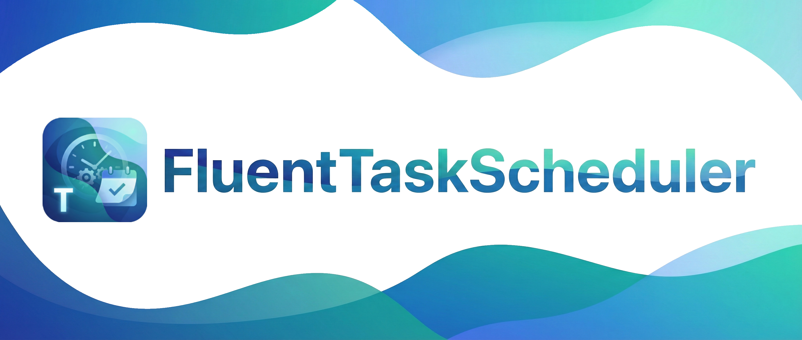
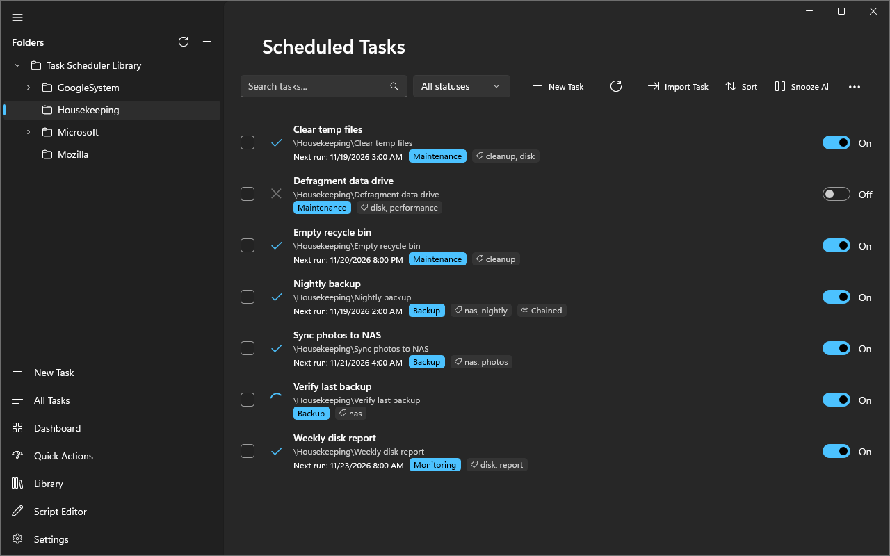
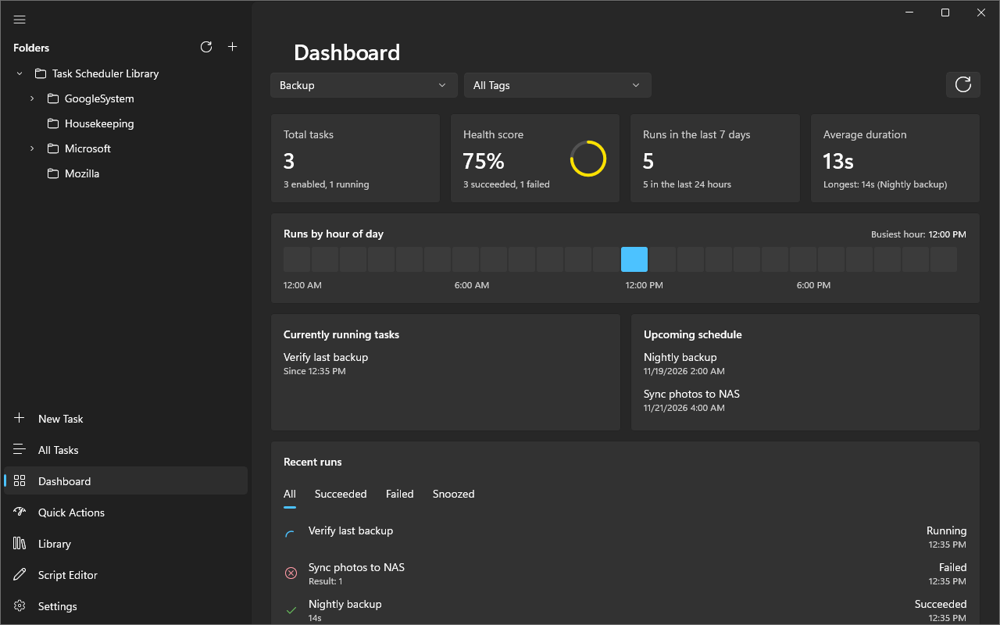
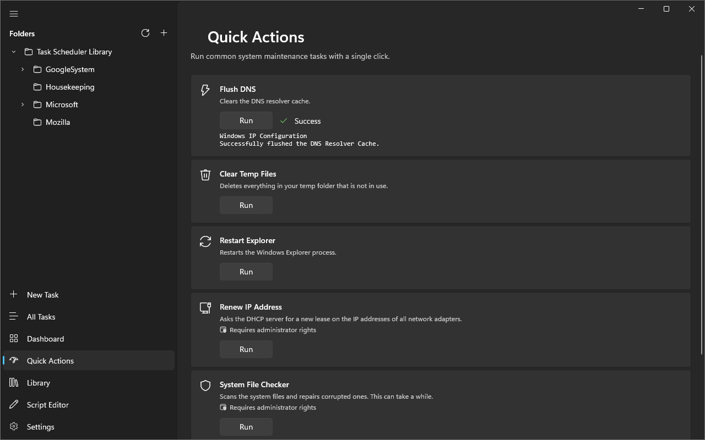
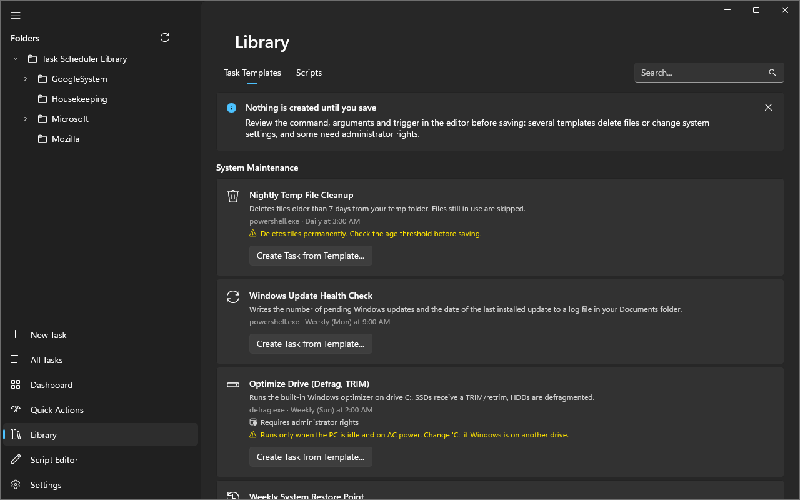
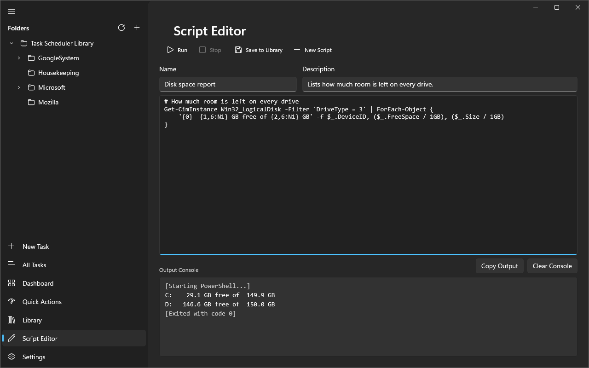
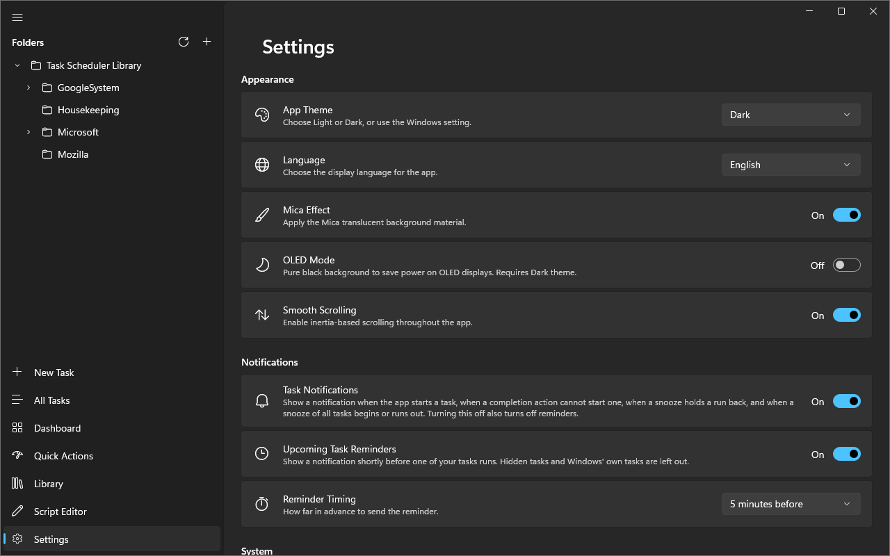
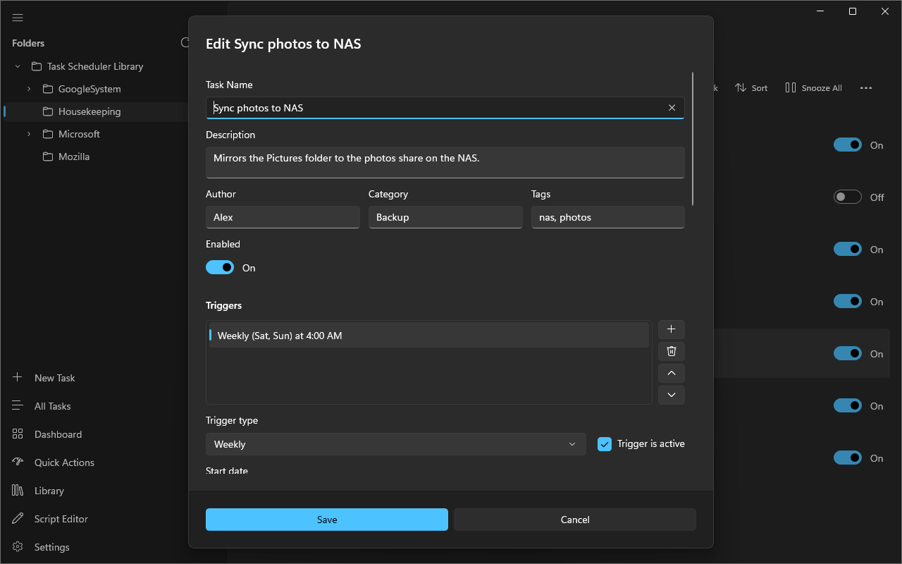
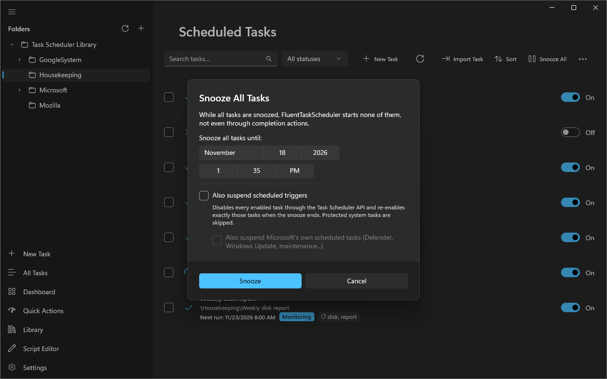

# FluentTaskScheduler

FluentTaskScheduler is a Windows app for the tasks of the Windows Task Scheduler. It shows what is
scheduled and when each task ran last, and, while Windows records task history, how its runs went.
You can create, change, start, stop, snooze and move tasks without the Task Scheduler console that
comes with Windows. Built with WinUI 3 and .NET 8.

Every task in the app is an ordinary Windows task. It runs on its schedule whether or not the app is
open.



> [!IMPORTANT]
> **AI Development Disclaimer**: This application was developed primarily with the assistance of Artificial Intelligence. Users should be aware that AI-generated code may contain unforeseen bugs, logic errors, or security vulnerabilities. Please test all tasks in a safe environment before deployment. The developer assumes no responsibility for any system instability or data loss resulting from the use of this software.

### Donate on Buy me a coffee
If you like what this project is for, I would really appreciate a (optional!) donation:
<br><a href="https://buymeacoffee.com/t.r.g"></a>

## Screenshots

<p align="center">
  
  
</p>
<p align="center">
  
  
</p>
<p align="center">
  
  
</p>
<p align="center">
  
  
</p>

## Installation

The app runs on Windows 10 version 1809 (build 17763) or later, on x64 and ARM64. It brings its own
.NET runtime and Windows App SDK, so nothing else has to be installed.

### From the releases page
Each release on the [releases page](https://github.com/TRGamer-tech/FluentTaskScheduler/releases)
offers two downloads per architecture (x64 and ARM64). The other files there are the update feed
that the app's updater reads.
- **Setup MSI**: an installer. You choose whether it installs the app for you alone or for all
  users.
- **Portable ZIP**: unpack it anywhere and start `FluentTaskScheduler.exe`, which starts the app in
  the `current` folder next to it. Keep the whole folder.

Both look for a new release each time the app starts, download it and ask whether to restart to
install it. Settings, About has a button for the same check. An installation for all users can only
update itself while the app runs as administrator.

### winget
```
winget install -e --id TRGamer-tech.FluentTaskScheduler
```

### Scoop
```
scoop bucket add extras
scoop install extras/fluenttaskscheduler
```

### Chocolatey
[Package page](https://community.chocolatey.org/packages/fluenttaskscheduler)
```
choco install fluenttaskscheduler
```

winget and Chocolatey install the Setup MSI. Scoop installs the portable ZIP.

## What it does

### The task list
- All tasks of the Task Scheduler in one list, or the tasks of one folder from the folder tree. A
  row shows the task's state, path, next run, category and tags, and a switch that enables or
  disables the task.
- Search by name, path, category or tag. Clicking a task's category puts it in the search box.
- Show only running, enabled, disabled or snoozed tasks.
- Sort by name, status, next run or last run. Choosing the same order again reverses it.
- Run, stop, enable, disable, move to another folder and delete tasks, one at a time or several at
  once.
- Export a task to an XML file, in the format the Task Scheduler itself uses.
- Import such a file, also one from another computer or user. The app shows what the task runs and
  when. You choose its name, its folder, the account it runs as and whether it runs with highest
  privileges before the task is registered.
- Folders: create, rename and delete them.
- Hidden tasks are shown dimmed, unless a setting hides them.
- A task you start from the app or with `--run` runs at once: its conditions and its rule for an
  instance that is already running do not apply. A task that a completion action starts is started
  the way its trigger would start it, so both apply.
- While Windows records task history (see [Task history in Windows](#task-history-in-windows)), the
  list keeps itself up to date. Runs that start and end show on their rows, and tasks that other
  programs create, change or delete appear, change and disappear.

### Task details
Clicking a task opens its details:
- its triggers in words and the command lines of its actions, its next and last run, its author,
  category and tags;
- its history from the event log of the Task Scheduler for today, yesterday, the last seven days or
  all that Windows kept, up to the newest 500 events;
- how many runs there were, how many succeeded and failed, and the last result. These numbers also
  filter the list of events;
- for a selected event, what the log says about it (event ID, level, result, action, account and
  run), and what the computer did within five minutes of it: start, shutdown, sleep, wake, logon
  and logoff;
- the history as a CSV file or on the clipboard;
- buttons to run, stop, edit, snooze, export and delete the task.

### Creating and changing tasks
The editor opens for a new task, for a task of the list, and for a template or script of the library.
A new task goes into the folder that is shown (the root folder while all tasks are shown) and starts
out with a daily trigger at the next full hour.

- **Triggers**, any number of them:
  - one time;
  - daily, every n days;
  - weekly, every n weeks on chosen days;
  - monthly, on chosen days of the month (the last day included) or on chosen weekdays of chosen
    weeks, such as the first Monday, in chosen months;
  - at log on, at startup, or on idle;
  - on an event, by log, source and event ID, or by your own XML query;
  - on a session change: lock, unlock, local or remote connect and disconnect.

  Every trigger can repeat at an interval, for a while or indefinitely. It can expire, and it can be
  switched off. Triggers at a time of day can also wait a random delay.
- **Actions**, any number of them, in order: start a program or script with arguments and a working
  folder. The add menu also has two PowerShell actions to fill in: one sends an email, one shows a
  message box. For PowerShell scripts, the editor shows which arguments to use.
- **Conditions**: start only when the computer is idle (and stop when it no longer is), only on AC
  power (and stop on battery), only with a network or with one particular network. Wake the computer
  to run the task.
- **Settings**: run with highest privileges, hide the task, start a missed run as soon as possible,
  stop the task after a time limit, restart it after a failure, choose what happens when it is
  already running, set its priority, delete it when it will not run again, and allow it to be ended
  by force.
- **Account**: run as you, as another user or as SYSTEM. A task set up here for a user runs while
  that user is signed in. A task for which Windows keeps a password asks for it again when it is
  saved.
- **Completion actions**: start other tasks when this one succeeds (exit code 0) or ends any other
  way. The app carries them out while it runs and Windows records task history. No task is started
  twice in one chain, and completion actions start a task at most 20 times in 10 minutes.
- **Category and tags**, for searching the list and narrowing the dashboard. The category field
  suggests the categories you used before and those listed in the settings. Category, tags and
  completion actions are kept in the task's description, so they travel with an exported task.

Saving writes only what changed. What the editor does not show stays as it was. Triggers and actions
of kinds the editor cannot change are listed and kept as they are.

### Dashboard
The dashboard sums up the last seven days, for all tasks or for one category or tag:
- the number of tasks, of enabled tasks and of running tasks;
- a health score: of the runs that succeeded or failed, the share that succeeded;
- the number of runs, and how many of them were in the last 24 hours;
- the average duration of a run, and the longest run with its task;
- at which hours of the day the runs began, and the busiest hour;
- the tasks that are running now, and the next five to run;
- a log of the newest 50 entries: runs, and starts that a snooze refused. It can be narrowed to
  succeeded, failed or snoozed.

A click on a task or a log entry leads to the task. While the dashboard is on screen and Windows
records task history, it adds runs as they happen. `F5` reads everything again.

### Snoozing
- Snooze all tasks for 30 minutes, an hour, three hours, until you sign out or restart Windows, or
  until a date and time you pick. This is in the toolbar of the task list and in the menu of the
  icon in the notification area.
- While all tasks are snoozed, the app starts none of them: not from the list, not from the command
  line and not as a completion action. Windows still starts tasks on their schedule, unless
  **Also suspend scheduled triggers** is chosen. Then the app disables every enabled task it is
  allowed to change (tasks Windows protects, and tasks it cannot see, stay enabled), and enables
  exactly those again when the snooze ends. The tasks of Windows itself, under `\Microsoft\`, are
  left alone unless you include them as well.
- Snooze a single task from its details, with the same choices. It is disabled until the snooze
  ends. A task that is disabled already is left as it is.
- A banner on the task list, a Snoozed badge and filter, the icon in the notification area and the
  dashboard show what is snoozed and which starts were refused.
- The app ends a snooze while it runs, also from the notification area. A snooze that ran out while
  the app was closed ends at the next start of the app.

### Quick actions
Six maintenance commands, one click each: flush the DNS cache, clear the temp folder, restart
Explorer, renew the IP address, run the System File Checker, and run a DISM health check. The last
three need administrator rights. Clearing the temp folder and restarting Explorer ask first. While a
command runs, the page shows its newest line and can stop it. Afterwards it shows how the command
ended and, where that helps, its last lines.

### Library and script editor
- **Templates**: 17 ready-made tasks in three groups (system maintenance, developer tools, power and
  utility), such as a temp folder cleanup, a weekly restore point, a Git fetch of every repository
  in a folder and up to two levels below it, and a shutdown at night when the computer is idle. A template opens the task
  editor filled in, and nothing is registered until you save. Most templates say what to check
  first.
- **Scripts**: 13 built-in commands and the PowerShell scripts you saved. **Create Task from Script**
  opens the editor with a task that runs it. A saved script runs as a file with
  `powershell.exe -NoProfile -NonInteractive -ExecutionPolicy Bypass -File`, so later changes to the
  script reach the tasks made from it.
- One search box covers templates and scripts.
- The **script editor** runs a PowerShell script with Windows PowerShell 5.1 and shows its output and
  errors as they arrive. It can stop the script, copy or clear the output, and save the script to
  the library with a name and a description.

### Settings
- Theme: light, dark or that of Windows. The Mica backdrop where Windows supports it. A black
  background for OLED screens in the dark theme.
- Language: English, German, Japanese or Simplified Chinese. Without a choice, the app uses the
  Windows display language, or its own translation of the same language (German for Austrian
  German, Simplified Chinese for Traditional Chinese), and English otherwise. A new language applies
  at once.
- Smooth scrolling, on by default.
- Notifications, on by default: when you start a task, when a completion action starts a task or
  cannot start one, when a snooze refuses a start, when a snooze of all tasks begins, and when it
  runs out. Ending a snooze yourself shows no notification.
- Reminders before an enabled task runs: 1, 5 (the default), 10, 15 or 30 minutes ahead. Hidden tasks
  and the tasks of Windows itself are left out.
- Start with Windows, for your account.
- Close to tray, on by default: closing the window hides it in the notification area, and the app
  keeps running. Minimize to tray, off by default, does the same for minimizing. The icon shows how
  many tasks are running and whether all tasks are snoozed. Its menu brings windows back, snoozes and
  resumes all tasks, opens another window and ends the app.
- Task pipelines, on by default: carry out completion actions.
- Show hidden tasks, on by default.
- Confirm before deleting, on by default.
- Logging, on by default, with errors in a file of their own unless Separate log files is switched
  off. Links open the log files and the data folder.
- Execution history log, off by default: the app keeps every finished run in monthly files of its
  own and deletes all but the twelve newest of them. The history of Windows is limited in size and
  overwrites itself.
- Export and import of the settings as a JSON file.
- Lists of categories and tags for your tasks.
- About: the version, a check for updates, the release notes, the welcome tour, and links to the
  source code and to report a problem.

Starting the app a second time brings its window back instead of opening a second copy. The window
opens at the size it had last. A welcome tour comes up at the first start, and the release notes of a
new version after an update.

### Keyboard shortcuts

On the task list:

| Shortcut   | Action                         |
| :--------- | :----------------------------- |
| `Ctrl + N` | Create a task                  |
| `Ctrl + E` | Edit the selected task         |
| `Ctrl + R` | Run the selected tasks         |
| `Delete`   | Delete the selected tasks      |
| `F5`       | Reload the task list           |
| `F1`       | Show the shortcut overview     |

`Ctrl + E`, `Ctrl + R` and `Delete` work while the list has the focus, so `Delete` in the search box
deletes text, not tasks. On the dashboard, `F5` reads everything again. In the script editor, `F5`
runs the script, `Shift + F5` stops it and `Ctrl + S` saves it to the library.

## Command line

`FluentTaskScheduler.exe` in the `current` folder of the app answers these commands without opening
a window, so scripts can use it. In an installation for you alone that is
`%LOCALAPPDATA%\FluentTaskScheduler\current\FluentTaskScheduler.exe`, in the portable ZIP
`current\FluentTaskScheduler.exe`. The `FluentTaskScheduler.exe` one folder up, which the Start menu
and the portable ZIP start, only launches the app: it returns at once and passes on neither the
answer nor the exit code.

A task is named by its path, as `--list` shows it. The commands work whether or not the app is open.

```powershell
$fts = "$env:LOCALAPPDATA\FluentTaskScheduler\current\FluentTaskScheduler.exe"

# All tasks as JSON: name, path, state, last run and next run
& $fts --list

# Start, enable or disable a task
& $fts --run "\Backups\Nightly"
& $fts --enable "\Backups\Nightly"
& $fts --disable "\Backups\Nightly"

# A task's history as CSV, newest event first (history.csv in the current folder unless a file is named)
& $fts --export-history "\Backups\Nightly" --output "C:\logs\history.csv"

# The usage (also -h and /?)
& $fts --help
```

The exit code is 0 on success, 1 when the command failed and 2 when it was not understood. A run that
a snooze prevents counts as failed.

This program is a windowed program as well, and shells do not always wait for those: PowerShell
waits only when the output goes into a pipeline or a variable, and cmd only inside a batch file.
Without waiting, the answer appears after the next prompt and `$LASTEXITCODE` still holds the code of
the command before. In PowerShell, pass the output on:

```powershell
$tasks = & $fts --list | ConvertFrom-Json
& $fts --run "\Backups\Nightly" | Out-Host
if ($LASTEXITCODE -ne 0) { throw "The task was not started." }
```

## Task history in Windows

Windows records what its tasks do only while the history log of the Task Scheduler is switched on,
and Windows comes with it switched off. Without it, the details and the dashboard show no new runs,
the task list does not notice changes made by other programs, and completion actions and the
execution history log stand still. The details of a task and the dashboard offer to switch it on,
which needs administrator rights. From an elevated prompt:

```
wevtutil sl Microsoft-Windows-TaskScheduler/Operational /e:true
```

## When the app is closed

The tasks run on their schedule whether or not the app is open. Completion actions, reminders,
notifications, the end of a snooze and the execution history log need the app to run. By default,
closing the window leaves the app running in the notification area.

## Administrator rights

The app starts without administrator rights. Windows then lists only the tasks you may read, and the
task list says so. A task that Windows lists but does not let you read shows an Unreadable badge.
Administrator rights are needed to change tasks of other users or of Windows, to save a task that
runs as SYSTEM or with highest privileges, to pick one particular network for a task's network
condition, to switch on the task history, and for three of the quick actions. The app says so when Windows refuses, and can restart itself as administrator.

## Where the app keeps its data

The app keeps its own files in `%LOCALAPPDATA%\FluentTaskScheduler`: the settings
(`settings.json`), the logs, the scripts you saved in the library (`Scripts`; the built-in ones come
with the app), the record of snoozes (`snooze.json`) and the execution history log
(`ExecutionHistory`). The environment variable `FLUENTTASKSCHEDULER_DATA` moves all of it to another
folder. The tasks themselves live in the Task Scheduler, not in the app.

An installation for you alone puts the app itself into the same folder, in `current` and
`packages`. To start afresh, delete the files above rather than the folder. Uninstalling such an
installation can remove the whole folder, settings and saved scripts included, so export the
settings and copy the `Scripts` folder first if you want to keep them.

Logging is on by default and can be switched off in the settings. What the app does goes to
`App_Log.txt`. Its errors go to `Error_Log.txt` while the setting Separate log files is on (the
default), and to `App_Log.txt` when it is off. A crash is always written to `Crash_Log.txt`, also
with logging off. A log file that reaches 1 MB is continued in a new one, and only the two newest
files of each log are kept.

## Building from source

See [CONTRIBUTING](CONTRIBUTING.md).

## Technology

- [.NET 8](https://dotnet.microsoft.com/download/dotnet/8.0) and [WinUI 3](https://learn.microsoft.com/windows/apps/winui/winui3/) (Windows App SDK)
- [TaskScheduler Managed Wrapper](https://github.com/dahall/TaskScheduler) for the Task Scheduler
- [Velopack](https://velopack.io/) for the installer and the updates
- GitHub Actions builds the app for x64 and ARM64 (thanks, TalyNone), and runs the unit tests and UI
  tests that drive the built app.

## License

This project is licensed under the MIT License - see the [LICENSE](LICENSE) file for details.
